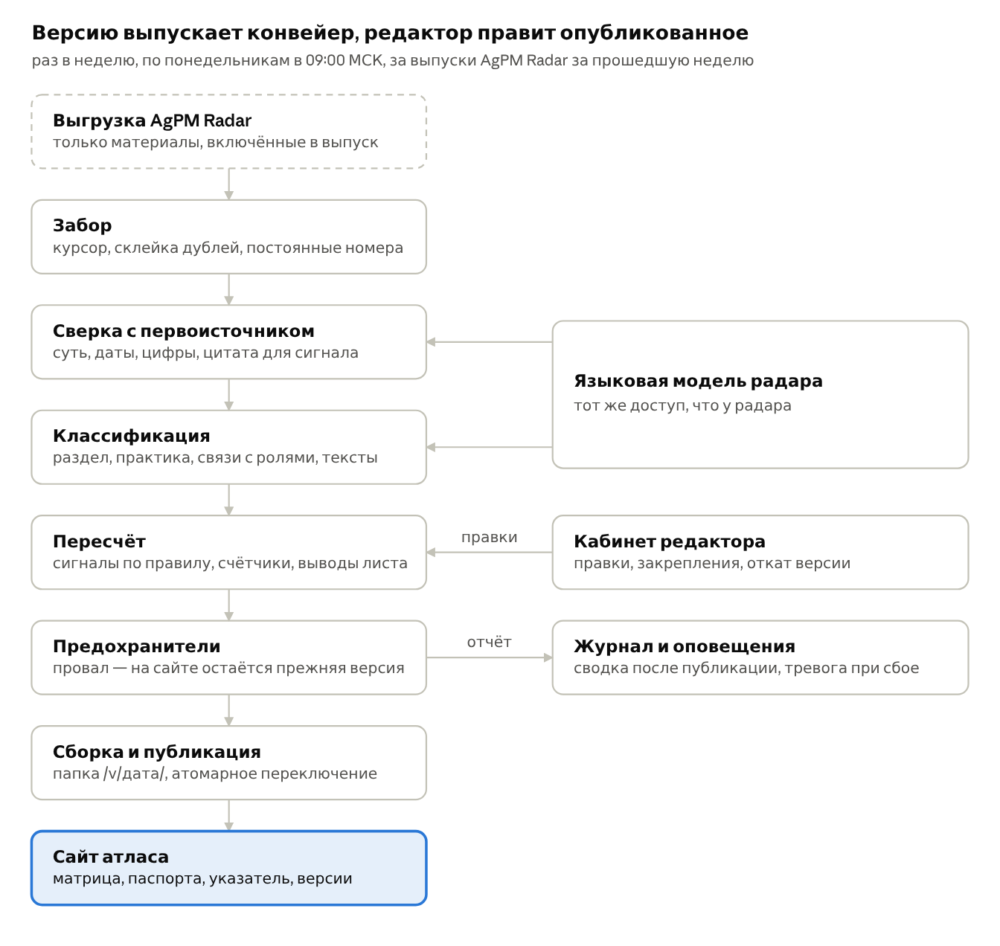
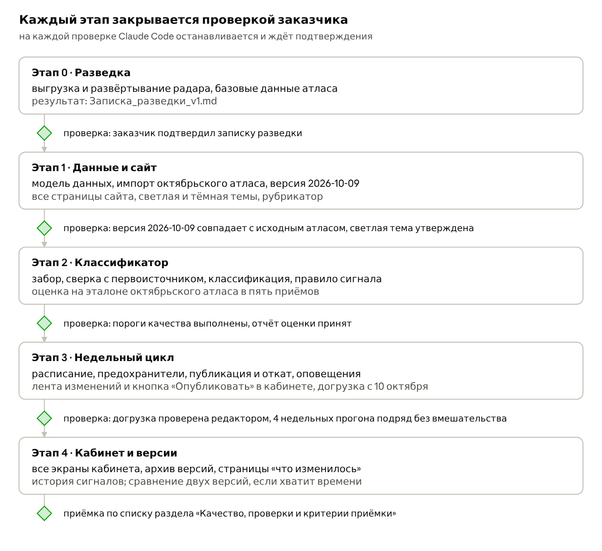

# Задание на разработку: еженедельный Атлас агентного управления проектами, v2

1 ноября 2026 · Helen · живая версия документа: https://claude.ai/artifact/RHhwnCeUPjyuJFtD4aAdyV

## Цель и результат

Нужно отдельное приложение «Атлас AgPM». Раз в неделю, по понедельникам после выхода утреннего выпуска AgPM Radar (08:00 МСК), оно забирает из выгрузки радара материалы за прошедшую неделю, сверяет их с первоисточниками, классифицирует по правилам атласа, пересобирает «Атлас агентного управления проектами» и само публикует новую версию сайта. Человек в недельном цикле не участвует: редактор правит уже опубликованное через свой кабинет.

Исходная точка — атлас-навигатор со срезом на 9 октября 2026 года (файл `AgPM_atlas_navigator_2026-10-09_AgPMO.html`, данные вынесены в приложенный `Атлас_базовые_данные_2026-10-09_v1.json`). В нём 794 материала радара, 17 сценариев главной матрицы, 9 соседних территорий, зона потерь и указатель из 9 разделов.

Читатели сайта — руководители проектов, проектные офисы и рабочая группа AgPM. Им нужно видеть, какую проектную работу агентам уже доверяют, насколько самостоятельно и на каких материалах держится каждая оценка. Редактор — заказчик или участник рабочей группы.

Приложение считается готовым при трёх условиях.

1. Недельный прогон без участия человека выпускает новую версию не позже 14:00 МСК понедельника, когда за неделю в радаре появились новые материалы, и не выпускает пустых версий, когда их нет.
2. На материалах октябрьского атласа классификатор воспроизводит ручную разметку не хуже порогов из раздела «Качество, проверки и критерии приёмки», а каждая цифра на сайте находится в тексте источника или выпуска радара.
3. Сайт повторяет все возможности октябрьского навигатора и добавляет светлую тему с переключателем, рубрикатор, постоянные адреса сценариев и разделов, архив версий со сводкой «что изменилось» и кабинет редактора.

## Атлас на 9 октября 2026: что переносим и что исправляем

Октябрьский атлас собран вручную и упакован в один HTML-файл в 1,4 МБ: шрифты и логотипы вшиты, данные лежат в блоке `<script id="atlasData">`, матрица нарисована готовым SVG 1440 × 1277 с абсолютными координатами. Методику, разметку и вид переносим целиком, устройство файла не переносим.

### Состав

| Часть | Что в ней | Число |
| --- | --- | --- |
| Главная матрица | 4 коридора видов проектной деятельности × 4 уровня самостоятельности агента | 17 сценариев: 4 «Подтвердилось», 10 «Заявлено», 3 «Не подтвердилось» |
| Соседние территории | применение агентов вне проектов, разложенное по тем же уровням | 9 территорий, 111 материалов |
| Зона потерь | вывод атласа в клетке IV × 3: на согласования и передачу работы уходит 35–60% времени | 4 материала, без сигнала |
| Паспорт | карточка под матрицей: клетка, сигнал с обоснованием, что делает агент, материалы с ролями | 27 паспортов |
| Указатель | все материалы с разделом, сценариями и доказательностью; фильтры по разделу, коридору, месяцу, поиск | 794 материала, 125 выпусков радара с 7 июня по 9 октября |
| Разделы указателя | матрица 70, соседние территории 77, практики контроля 114, инциденты 35, нормы 35, инструменты 132, экономика 75, зрелость и опросы 48, фон 208 | 9 разделов, в «Практиках контроля» 16 подразделов |

Из 794 материалов 282 подкрепляют сценарии, остальные лежат только в указателе. Связи со сценариями не привязаны к разделу: из 174 материалов матрицы 69 лежат в разделе «Матрица», остальные в «Фоне», «Инструментах», «Инцидентах» и других. На одном материале может держаться несколько сценариев, и оценки в них бывают противоположными: редакционный обзор № 117 подкрепляет «Подсказки и черновики планов» и опровергает «Самостоятельные действия в системах».

### Данные в файле

| Объект | Поля | Как заполнены |
| --- | --- | --- |
| Пункт атласа (`items`, 27) | `kind` (matrix, out, loss), `cor` (I–IV, out), `lv` (1–4), `code`, `short`, `title`, `where`, `sig` (confirmed, claimed, refuted), `tag`, `why`, `what`, `mats` | `mats` — список троек «материал, роль, оценка»; подпись карточки на матрице хранится только в SVG |
| Материал (`mats`, 794) | `id` (№ N), `u` (адрес), `o` (издание), `t` (название), `s` (суть), `n` (цифры), `k` (вывод для проектной работы), `ty` (тип), `ev` (доказательность), `fl` (флаг), `ds` (происхождение описания), `sec` (раздел), `pr` (практика), `d` (дата строкой), `mo` (месяц радара), `pts` (сценарии) | `ev`: средняя 632, слабая 154, сильная 8; `ds`: сверено 681, из выпуска радара 75, по названию 4, нет описания 34; цифры есть у 185, вывод у 84; 25 типов материала |
| Справочники | `sec` (9 разделов), `mon` (месяцы), `order` (порядок указателя) | 16 практик контроля и 15 ролей материалов заданы строками, отдельного справочника нет |

### Интерфейс, который переносим

Нажатие на карточку матрицы открывает паспорт, адрес `#ключ` открывает его сразу, Esc закрывает. Карточки доступны с клавиатуры. Сигнал читается и без цвета: сплошной зелёный круг, янтарное кольцо, красное кольцо с крестом. Рядом со знаком стоит число материалов, под названием сценария — опорный факт. В указателе строка раскрывает суть, цифры, вывод и ссылку, а значок сценария в строке открывает его паспорт. Поиск не различает «е» и «ё». Стиль октябрьского файла — пресет AgPMO, в приложении заменён собственным оформлением атласа (раздел «Сайт»): шрифты Jost, Manrope и JetBrains Mono, тёмный фон с подсветками и сеткой, цвета состояний `#34D08A`, `#E08A1E`, `#E0463C`.

### Что исправляем

| № | Находка | Чем опасна при недельной сборке | Решение |
| --- | --- | --- | --- |
| 1 | Выводы листа зашиты в SVG: скобки «Подтверждения есть, когда решает человек» и «Пока заявления и сбои», абзац «Разрыв с проектной работой», пунктир вокруг коридора IV | первое же подтверждение на уровне 4 сделает текст листа ложным | выводы хранятся как тексты редактора с проверяемым условием; условие не выполнено — текст снимается с листа, редактор получает оповещение |
| 2 | Счётчики легенды, коридоров, фильтров и подвала написаны текстом | числа разойдутся с данными на первой сборке | все числа на сайте считаются из данных при сборке |
| 3 | Связь «материал — сценарий» хранится дважды: в `items.mats` и в `mats.pts` | два источника правды расходятся при первой ручной правке | одна таблица связей |
| 4 | Оценка связи не совпадает с её влиянием на сигнал: в «Подсказках и черновиках планов» связь с № 117 помечена `good`, а сигнал остался «Заявлено», потому что методика обзора не описана | правило сигнала нельзя вычислить по оценкам: простое правило даёт 25 совпадений из 26 | у связи появляется отдельный признак «считается для сигнала», правило из раздела «Классификация и правила атласа» даёт 26 из 26 |
| 5 | Все даты — одна строка: «18 декабря 2025» или «в радаре 7 июня 2026» (184 материала) | нельзя фильтровать и сортировать по дате публикации | два поля: дата публикации (или «не установлена») и даты выпусков радара |
| 6 | Указатель рисует все строки сразу, данные и шрифты вшиты в страницу | через полгода в атласе будет около 3000 материалов | данные указателя грузятся отдельным файлом, строки выводятся порциями |
| 7 | Только тёмная тема, цвета SVG записаны в атрибутах (`fill="#F2F3F8"`) | светлую тему нельзя включить без перерисовки | цвета матрицы через переменные CSS, матрица раскладывается алгоритмом по данным |
| 8 | Три материала исключены «не по теме» без списка; «стартовый корпус» упомянут без описания | скрытое исключение нельзя проверить | реестр исключённых с причиной, виден в кабинете |
| 9 | У зоны потерь нет сигнала, а её вывод держится на сводке консультанта McKinsey | правило сигналов к ней неприменимо | зона потерь остаётся текстом редактора; приложение только добавляет к ней материалы и предлагает редактору новые цифры |

Номера № 1–794 уже цитируются в роликах и разборах, поэтому они сохраняются навсегда, а новые материалы получают следующие номера, начиная с 795.

## Границы задания

В задание входят недельный конвейер (забор, сверка, классификация, пересчёт, сборка, публикация), публичный сайт атласа, закрытый кабинет редактора, архив версий, перенос октябрьского атласа и догрузка материалов радара с 10 октября 2026 года по день запуска.

В задание не входят доработка самого радара, газета «Новости Агентного управления», ролики, английская версия, учётные записи читателей и публичные выгрузки (JSON, лента изменений, PDF среза). Данные сайта всё равно собираются в JSON, так что выгрузки потом добавляются без переделки.

Решения заказчика, на которых стоит задание:

| Вопрос | Решение | Что из него следует |
| --- | --- | --- |
| Откуда брать материалы | готовая выгрузка радара (программный интерфейс или JSON), адрес и ключ даёт заказчик | радар не меняем; атлас читает выгрузку через переходник с таблицей соответствия полей |
| Что публикуется само | всё: новая версия целиком, с журналом изменений и откатом | качество держат автоматические предохранители и последующий контроль редактора |
| Где работает и чем классифицирует | рядом с радаром, с тем же доступом к языковой модели | первый шаг Claude Code — изучить развёртывание радара и повторить его стек; обращение к модели идёт через слой, не зависящий от поставщика |
| Что ещё на сайте | страницы сценариев и разделов, версии и «что изменилось», кабинет редактора | у каждого паспорта и раздела постоянный адрес, каждая версия сохраняется |

Допущения до ответа заказчика: адрес сайта `atlas.agpm.space`, сайт открыт для всех и для поисковиков, кабинет доступен только по входу, оповещения редактору идут в Телеграм (Telegram) и на почту. Каждое допущение вынесено в раздел «Открытые вопросы» и задаётся в настройках приложения.

## Устройство приложения

Приложение состоит из недельного конвейера, базы данных, статического сайта и кабинета редактора. Сайт собирается в готовые файлы: читатели не зависят от состояния конвейера, каждая версия хранится целиком, откат сводится к переключению указателя текущей версии.

Модель радара работает только на сверке и классификации; сигналы, счётчики и выводы листа считает код, а правки редактора входят в цикл на шаге пересчёта.

| Компонент | Что делает | Вход → выход |
| --- | --- | --- |
| 1. Забор | по понедельникам в 09:00 МСК читает выгрузку радара с места прошлого прогона — все выпуски за неделю, нормализует адреса, склеивает дубли, присваивает постоянные номера | выгрузка радара → новые и обновлённые материалы |
| 2. Сверка | открывает страницу источника, извлекает текст, сверяет описание радара и цифры, проставляет происхождение описания | материал → текст источника в закрытом хранилище, сверенная суть |
| 3. Классификация | через языковую модель радара решает, относится ли материал к теме, его раздел, практику, тип, доказательность, флаги, связи со сценариями; предлагает новые сценарии и тексты паспортов | материал и текущий атлас → решения с обоснованием, версией инструкции и идентификатором модели |
| 4. Пересчёт | код без модели: сигналы по правилу, счётчики, условия выводов листа; правки и закрепления редактора всегда поверх автоматики | база → снимок версии (неизменяемый JSON) |
| 5. Предохранители | проверки снимка и собранного сайта; провал блокирующей проверки оставляет на сайте прежнюю версию | снимок и сайт → разрешение на публикацию или отчёт об ошибке |
| 6. Сборка сайта | страницы, раскладка матрицы, данные указателя, страница «Что изменилось» | снимок → папка версии `/v/ГГГГ-ММ-ДД/` |
| 7. Публикация | атомарно переключает текущую версию, хранит все прежние, откатывает по команде | папка версии → сайт |
| 8. Кабинет редактора | серверное приложение за входом: лента изменений, правки, закрепления, откат, внеочередной выпуск версии | действия редактора → правки в базе и запуск пересчёта |
| 9. Журнал и оповещения | журнал прогонов и расходов на модель, сводка редактору после каждой публикации, тревога при сбое | события → сообщения в Телеграм и на почту |

Стек повторяет стек радара: язык, базу данных, способ выкладки, доступ к модели и секреты Claude Code берёт те же. Если радар не задаёт какой-то из них, действует выбор по умолчанию: конвейер на Python 3.12, база PostgreSQL, страницы из шаблонов без сторонних библиотек интерфейса, кабинет на том же языке, запуск по расписанию средствами сервера. Выбор стека Claude Code фиксирует в записке разведки (этап 0).

## Модель данных

Источник правды — база данных приложения; сайт собирается из её неизменяемого снимка. У каждого поля, которое может заполнить модель, хранится происхождение (импорт, модель с версией инструкции, редактор) и признак закрепления: закреплённое поле автоматика не меняет.

### Материал

| Поле | Содержание | Правило |
| --- | --- | --- |
| `id`, `num` | внутренний ключ `m000795` и номер для показа «№ 795» | выдаются один раз и не меняются; № 1–794 из октябрьского атласа сохраняются |
| `radar_id` | идентификатор в выгрузке радара | у склеенного материала их несколько |
| `url`, `url_norm` | адрес и нормализованный адрес | `url_norm` не повторяется, по нему склеиваются дубли |
| `outlet` | издание | домен без www, если радар не дал названия |
| `title`, `title_orig` | название на русском и в оригинале | перевод без кальки, имена собственные как в источнике |
| `summary` | суть | до 70 слов, с цифрами, если они есть |
| `numbers` | цифры списком | у каждой отметка, где она найдена: в тексте источника или в выпуске радара |
| `takeaway` | вывод для проектной работы | необязателен; одно предложение с конкретным действием |
| `type`, `evidence`, `flags` | тип, доказательность, флаги | закрытые списки из раздела «Классификация и правила атласа» |
| `desc_origin` | происхождение описания | сверено с источником, из выпуска радара, по названию, нет описания |
| `section`, `practice` | раздел и практика | ровно один раздел из 9; практика только в разделе «Практики контроля» |
| `perimeter` | периметр радара | близкий, средний, дальний, разбор; берётся из выгрузки |
| `pub_date`, `pub_date_origin` | дата публикации и откуда она | может быть пустой, тогда на сайте «дата не установлена» |
| `radar_dates`, `first_seen`, `month` | даты выпусков радара, первая из них, её месяц | фильтр «месяц» строится по `month`, как в октябрьском атласе |
| `status` | в атласе, исключён, дубль | у исключённого — причина, у дубля — ссылка на основной материал; номер выдаётся только материалу в атласе |

### Пункт атласа (сценарий, территория, зона потерь)

| Поле | Содержание | Правило |
| --- | --- | --- |
| `key` | постоянный ключ (`B1_drafts`) | часть адреса страницы; старые ключи сохраняются, в том числе для адресов `#ключ` |
| `kind` | сценарий матрицы, соседняя территория, зона потерь | зона потерь одна и принадлежит редактору |
| `corridor`, `sub_area`, `level` | коридор I–IV, подобласть, уровень 1–4 | автоматика задаёт их только новому сценарию; перенос существующего сценария делает редактор |
| `title`, `short`, `card_line` | название, короткое название, опорный факт под названием | опорный факт взят из материала с самой сильной связью, до трёх строк |
| `what`, `why` | что делает агент; обоснование сигнала | `why` ссылается на материалы, которые определили сигнал, до 400 знаков |
| `signal`, `signal_origin` | сигнал и кто его задал | правило или редактор с причиной; сигнал редактора виден в паспорте |
| `status` | действует, новый, объединён, снят | «новый» держится 14 дней; снятый и объединённый сценарий открывает страницу с переходом |

### Связь материала с пунктом

| Поле | Содержание | Правило |
| --- | --- | --- |
| `material_id`, `item_key` | что с чем связано | единственное место хранения связи |
| `role`, `grade` | роль из 15 и оценка (подтверждает, заявляет, предупреждает, опровергает, фон) | переносятся из октябрьского `good`, `claim`, `warm`, `stop` и пустой оценки |
| `counts` | учитывается ли связь для сигнала и почему | задаётся правилом из раздела «Классификация и правила атласа» |
| `basis` | одна фраза: почему такая роль | показывается редактору, на сайте не выводится |

### Служебные объекты

| Объект | Поля |
| --- | --- |
| Справочники | разделы (9), практики (16), коридоры (4) с подобластями, уровни (4), роли (15), типы, флаги: ключ, название, определение, порядок |
| Текст листа | ключ, текст, место на листе, условие над данными, состояние (показан, снят по условию) |
| Версия | идентификатор «ГГГГ-ММ-ДД» (вторая за день — с суффиксом «-2»), дата среза, счётчики, список изменений, результаты проверок, состояние, предыдущая версия |
| Правка | кто (автоматика или редактор), когда, объект, поле, было, стало, причина, версия |
| Прогон | начало, конец, курсор выгрузки «с» и «по», счётчики по шагам, обращения к модели и их стоимость, итог проверок, ошибка |

## Забор материалов из выгрузки радара

Атлас берёт из радара только материалы, включённые в выпуск; отсечённые радаром в атлас не попадают. Выгрузку читает переходник, а соответствие полей радара и атласа лежит в файле настроек: при смене формата радара меняется только он.

**Контракт.** Адрес и ключ выгрузки даёт заказчик. До написания кода Claude Code читает описание выгрузки, забирает образец за 7 дней и составляет таблицу «поле радара → поле атласа». Из выгрузки нужны идентификатор, адрес, название, издание, дата выпуска радара, дата публикации, периметр, тип, доказательность, флаги, суть и цифры. Поле, которого в выгрузке нет, заполняет сверка или классификация с отметкой происхождения.

**Расписание.** Радар выходит каждый день в 08:00 МСК, атлас собирается раз в неделю: прогон стартует в понедельник в 09:00 и забирает выпуски радара за семь дней, включая утренний понедельничный. Выгрузка недоступна — повтор каждый час до 18:00, затем тревога «выгрузка радара недоступна»; редактор может запустить внеочередной прогон из кабинета, иначе следующий недельный прогон заберёт две недели. Если за неделю выпусков не было, версия не создаётся. День недели, время и часовой пояс задаются в настройках.

**Курсор и повторы.** Прогон читает выгрузку от курсора прошлого успешного прогона с нахлёстом 3 дня, чтобы поймать поздние правки радара. Повторный запуск на тех же данных даёт тот же результат и не создаёт дублей. Запросы к радару идут с ожиданием ответа до 30 секунд и тремя повторами с нарастающей паузой.

**Нормализация адреса.** Адрес приводится к https, имя узла — к нижнему регистру без www. Удаляются хвостовой «/», якорь и параметры отслеживания (`utm_*`, `fbclid`, `gclid`, `yclid`, `mc_*`, `ref`), оставшиеся параметры сортируются. Правила нормализации покрываются модульными проверками на адресах из октябрьского атласа.

**Дубли.** Совпавший нормализованный адрес склеивается с уже известным материалом: дата выпуска радара добавляется к `radar_dates`, номер остаётся прежним. Повтор в радаре служит признаком внимания к теме и не повышает доказательность. Разные адреса с одним содержанием (перепечатка пресс-релиза на finance.yahoo.com) остаются отдельными материалами с ролью «перепечатка»; совпадение названий при разных адресах попадает в кабинет как вероятный дубль.

**Правки радара.** Если радар изменил карточку, которая уже есть в атласе, незакреплённые поля обновляются, изменение попадает в журнал, а новая суть снова идёт на сверку. Пропавшая из выгрузки карточка из атласа не удаляется и попадает в кабинет.

**Номера.** Номер выдаётся на шаге пересчёта, когда классификация решила, что материал по теме. Порядок — по дате первого выпуска радара, затем по порядку в выпуске. Исключённый и потом возвращённый редактором материал получает следующий свободный номер; номера не переиспользуются.

## Сверка с первоисточником

Каждый новый материал сверяется со страницей источника, как в октябрьском атласе, где сверено 681 описание из 794. Сверка решает две задачи: исправляет суть и цифры радара и даёт текст, по которому автоматика проверяет каждую цифру на сайте.

**Как открываем.** Обычный запрос с честным представлением клиента (`AgPM-Atlas/1.0` и адрес сайта атласа), ожидание до 20 секунд, два повтора, не больше одного запроса в секунду к одному сайту, соблюдение robots.txt. Страницы, которым нужен браузер, открываются встроенным безголовым браузером. Платный доступ, вход и защита от роботов не обходятся: такой материал остаётся с описанием радара.

**Что храним.** Извлечённый основной текст страницы, дату и отпечаток содержимого — в закрытом хранилище, для повторных проверок и для редактора. На сайте публикуются только суть своими словами до 70 слов, цифры и ссылка; текст источника и длинные цитаты в открытый доступ не попадают.

**Что сверяем.** Модель сравнивает суть радара с текстом источника и возвращает одно из трёх решений: подтверждена, исправлена (с новой сутью и списком расхождений), не относится к странице. Отдельно сверяются дата публикации, тип материала и то, кто говорит: продавец, консультант, исследователь или организация-пользователь. От этого зависит роль материала и сигнал сценария.

**Цифры.** Каждое число из `numbers`, `summary`, `why`, `what` и `card_line` проверяется кодом: оно должно буквально встречаться в тексте источника или в выпуске радара, с учётом разного написания («1,4 млн» и «1.4 million», «35–60%» и «35-60 percent»). Число, полученное счётом («вдвое», «− 75%»), хранит формулу и исходные числа, которые проверяются так же. Цифры продавцов и консультантов идут с пометкой «как заявлено».

**Происхождение описания.** Страница открылась и суть сверена — «сверено с источником». Страница не открылась — «из выпуска радара»; в выпуске только название — «по названию»; ничего нет — «нет описания». Тексты этих пометок берутся из октябрьского навигатора без изменений. Неоткрывшаяся страница ставится в повтор ещё на 6 дней, затем раз в месяц.

**Строже для материалов, на которых держится сигнал.** Материал может подтвердить или опровергнуть сценарий только со статусом «сверено с источником». Для такого материала модель отдельно приводит дословную цитату из источника, на которой стоит оценка, а код проверяет, что цитата есть в тексте; цитата видна редактору в кабинете.

## Классификация и правила атласа

Модель размечает каждый материал и пишет тексты, а сигналы, счётчики и видимость выводов листа считает код по правилам ниже. Правила взяты из подвала и данных октябрьского атласа и хранятся в репозитории одним файлом `Правила_атласа.md`, из которого собираются и инструкции модели, и страница «О методике».

### Что решает модель по материалу

| Решение | Варианты | Правило |
| --- | --- | --- |
| По теме | в атласе или исключён | исключается материал не об ИИ-агентах и не об их управлении; причина обязательна |
| Раздел | один из 9 | раздел — главный предмет материала; связи со сценариями от раздела не зависят |
| Практика | одна из 16 | только для раздела «Практики контроля» |
| Тип | 26 типов октябрьского атласа | новый тип добавляет только редактор |
| Доказательность | сильная, средняя, слабая | пересказ и перепечатка не повышают доказательность; сильная — только исследование, опрос или тест с описанной методикой |
| Флаги | «как заявлено», «нет управленческого контура», мнимая агентность (agent wash) | «как заявлено» ставится всем цифрам продавца |
| Связи | 0 и больше связей с ролью, оценкой, обоснованием и цитатой | связь ставится, если материал говорит об этой функции агента на этом уровне самостоятельности |
| Новый сценарий | предложение с коридором, уровнем, названием | если ни один существующий сценарий не подходит |
| Тексты | суть, цифры, вывод для проектной работы | вывод пишется, только когда из материала следует конкретное действие (в октябре — у 84 из 794) |

### Девять разделов

| Раздел | Что в него попадает | В октябре |
| --- | --- | --- |
| Главная матрица: сценарии проектной работы | что агент делает в проектной работе: кейс, пилот, продукт с описанием работы на проектной функции | 70 |
| Соседние территории | то же вне проектов: поддержка клиентов, ИТ и безопасность, продажи, финансы, маркетинг, инвестиции, страхование, фарма, логистика | 77 |
| Практики контроля | как организации управляют агентами; 16 практик, от «Права ступенями и границы полномочий» (19) до «Стоп-кран и откат» (1) | 114 |
| Инциденты | сбой, ошибка, атака, утечка или ущерб от действий агента | 35 |
| Нормы и стандарты | законы, регулирование, стандарты, рамки отраслевых организаций | 35 |
| Инструменты и продукты | выпуски и описания продуктов, платформ, протоколов без описания применения | 132 |
| Экономика и деньги | цены, расходы, сделки, раунды, денежная оценка эффекта | 75 |
| Зрелость и опросы | опросы, индексы, модели зрелости, данные о распространённости | 48 |
| Фон: тренды, обучение, мероприятия | прогнозы, мнения, обучение, мероприятия, общие обзоры | 208 |

Определения составлены по названиям разделов и их составу. Claude Code уточняет их и порядок старшинства для спорных случаев так, чтобы совпадение с октябрьской разметкой было наибольшим, и выносит итог на согласование заказчику. Отправная точка старшинства: инциденты, нормы, практики контроля, матрица, соседние территории, зрелость, экономика, инструменты, фон.

### Оси матрицы

Коридоры и их подобласти: I «Отбор и планирование» — входящие заявки и отбор; планирование, сроки, ресурсы. II «Контроль и отчётность» — статусы и контроль исполнения; риски и отклонения; отчётность и комитеты. III «Исполнение» — задачи команды: код, аналитика, интеграции. IV «Решения и координация» — изменения и решения; передача работы между командами.

Уровни самостоятельности: 1 «Подсказывает» — человек делает сам; 2 «Готовит» — человек утверждает; 3 «Делает с подтверждением» — каждый шаг подтверждает человек; 4 «Делает сам в границах» — человек смотрит журнал. Уровень связи выбирается по тому, что агент делает в описанном случае; обещание продавца на будущее ставится на обещанный уровень с ролью «обещание».

### Роли материалов

| Роль | Оценка | Считается для сигнала | В октябре |
| --- | --- | --- | --- |
| внедрение с именем | подтверждает | да, если организация-пользователь, которая сама не продаёт такие решения, рассказала о применении сама: в блоге, пресс-релизе, интервью или своими словами в кейсе продавца | 13 |
| независимый обзор | подтверждает или опровергает | подтверждение — только при описанной методике; опровержение — при описанном конкретном сбое | 2 |
| опровержение | опровергает | да: независимый тест, практическая проверка или исследование показали сбой | 4 |
| кейс по данным продавца | заявляет | нет: клиент назван, но результат приводит только продавец | 18 |
| продукт, обещание, пилот, консультинг | заявляет | нет | 149, 87, 1, 1 |
| риск, проблема, пример компании | предупреждает | нет | 21, 5, 2 |
| контекст, перепечатка, опрос, сводка исследований | фон | нет | 43, 26, 8, 1 |

Учитываемая связь требует материала со статусом «сверено с источником» и дословной цитаты. Все 19 связей, держащих октябрьские сигналы, этому требованию уже отвечают. Правило асимметрично: для подтверждения независимому обзору нужна методика, для опровержения достаточно конкретного сбоя («Проверка зависимостей между задачами» опровергнута практической проверкой без описанной методики). Асимметрия перенесена как есть и вынесена в открытые вопросы.

### Правило сигнала

1. «Подтвердилось» — есть хотя бы одна учитываемая связь «подтверждает» и нет учитываемых «опровергает».
2. «Не подтвердилось» — есть хотя бы одна учитываемая связь «опровергает» и нет учитываемых «подтверждает».
3. «Заявлено» — учитываемых связей нет, а связи с другими ролями есть.
4. Есть и те, и другие — конфликт: сигнал остаётся прежним (у нового сценария — «Заявлено»), в паспорте появляется строка «Есть и подтверждение, и опровержение», пункт попадает в очередь редактора.
5. Сигнал, заданный редактором, действует до снятия закрепления и помечен в паспорте.

На октябрьских данных это правило воспроизводит все 26 сигналов при одном уточнении: связь № 117 с «Подсказками и черновиками планов» переносится как неучитываемая, с основанием «методика не описана». Прогон правила на октябрьских данных входит в обязательные проверки. Правило одинаково для сценариев и соседних территорий; у зоны потерь сигнала нет.

### Новые сценарии и территории

Предложения модели копятся в списке кандидатов и склеиваются по смыслу. Кандидат становится сценарием, когда за 60 дней его подкрепили хотя бы 3 материала от 2 разных изданий, или сразу при первой учитываемой связи. Новый сценарий публикуется сам с меткой «новый» на 14 дней и попадает в очередь редактора. Перенос сценария в другую клетку, объединение, разделение и снятие автоматика не делает: такие шаги меняют методику, их делает редактор в кабинете.

### Тексты паспортов

Поле `what` (что делает агент) пишется один раз, при создании сценария, и дальше меняется только редактором. Поля `why` и `card_line` переписываются автоматически, когда меняется набор учитываемых связей или появляется материал с более сильной ролью. Старшинство для выбора опорного факта: внедрение с именем, опровержение, независимый обзор, кейс по данным продавца, продукт (тогда перечень до трёх продавцов, как «monday.com, Kimi, Kiplot»). Длины: `what` до 200 знаков, `why` до 400, `card_line` до трёх строк по 38 знаков.

### Язык создаваемых текстов

Русский язык с ёфикацией и кавычками-«ёлочками» (вложенные — „лапки“). Английские термины допускаются только в скобках для собственных имён и стандартов; названия компаний и продуктов пишутся как в оригинале. Запрещены слова «важный», «ключевой», «уникальный» и однокоренные, оборот «это не X, а Y» и начало предложения со слов «Вот», «Это», «Здесь». Числа пишутся по русским правилам: неразрывный пробел в тысячах, запятая в дробях, тире в диапазонах с неразрывным соединителем (как в октябрьском атласе). Проверку делает код: кавычки и пробелы исправляются сами, ё ставится по словарю однозначных слов, запрещённые обороты ведут к одной перегенерации, затем текст уходит в очередь редактора, а на сайте остаётся прежний.

### Работа с моделью

Обращения идут через тот же доступ к языковой модели, что у радара, через слой с одним интерфейсом «запрос → ответ по схеме». Ответ модели — JSON по схеме с закрытыми списками; невалидный ответ повторяется один раз с текстом ошибки, после второй неудачи материал переносится на следующий прогон. Инструкции версионируются в репозитории, примеры в них берутся из октябрьской разметки (по 2–3 на раздел и роль, ближайшие по смыслу, если модель радара даёт векторное представление текста). При каждом решении сохраняются идентификатор модели и версия инструкции. Предел расходов на модель за один прогон задаётся в настройках; при его исчерпании публикуется уже разобранное, остальное идёт в следующий прогон, редактор получает оповещение.

## Пересборка и автоматическая публикация

Новая версия выходит сама, если прошла все блокирующие проверки; иначе на сайте остаётся предыдущая, а редактор получает отчёт. Если новых материалов и правок редактора нет, версия не создаётся.

### Блокирующие проверки

| Проверка | Условие прохождения |
| --- | --- |
| Целостность данных | снимок соответствует схеме; все связи ведут к существующим материалам и пунктам; у каждого материала один раздел |
| Номера | номера не повторяются, ни один прежний номер не изменился |
| Потери | число материалов в атласе не уменьшилось, кроме исключённых редактором |
| Цифры | каждое число в публичных текстах найдено в источнике или выпуске радара; текст с ненайденным числом заменяется прежним, а если прежнего нет — материал переносится на следующий прогон |
| Правило сигнала | на контрольном наборе октября получается 26 из 26 сигналов |
| Резкие изменения | за недельный прогон сменилось не больше 3 сигналов и не больше 5% старых связей; при превышении версия ждёт кнопки «Опубликовать» в кабинете: массовая смена оценок чаще означает сбой модели, чем новости |
| Сайт | все страницы собраны, внутренние ссылки работают, автоматическая проверка доступности без серьёзных нарушений в обеих темах, страницы укладываются в бюджет размера |

Неблокирующие замечания идут в очередь редактора: нарушения языка после перегенерации, неоткрывшиеся источники, вероятные дубли, конфликты сигналов, новые сценарии и кандидаты, превышение бюджета на модель.

### Устойчивость оценок

Сигнал меняется только из-за сверенного материала с дословной цитатой. Сменившийся сигнал 14 дней несёт на карточке отметку «сигнал изменён ДД.ММ», а в паспорте показывает прежний сигнал и материал, из-за которого он сменился. Редактор получает оповещение в момент публикации. Закреплённые редактором поля, связи и сигналы автоматика не трогает, связи из октябрьской ручной разметки не удаляет.

### Выводы листа с условиями

Выводы октябрьского листа переносятся как тексты редактора с условиями. После каждого пересчёта код проверяет условие; не выполнено — текст снимается с листа, редактор получает оповещение и пишет новый. Числа внутри выводов подставляются из данных с согласованием слов («одно заявление», «два опровержения»).

| Вывод листа | Условие показа |
| --- | --- |
| Скобка уровней 1–3 «Подтверждения есть, когда решает человек» | на уровнях 1–3 матрицы есть хотя бы один сценарий «Подтвердилось» |
| Скобка уровня 4 «Пока заявления и сбои» | на уровне 4 матрицы нет ни одного «Подтвердилось» |
| «Разрыв с проектной работой» под соседними территориями | на уровне 4 есть подтверждённая соседняя территория и нет подтверждённого сценария матрицы; числа заявлений и опровержений — из данных |
| Пунктир вокруг коридора IV «самые большие потери и меньше всего доказательств» | в коридоре IV нет «Подтвердилось» и на нём меньше всего материалов среди четырёх коридоров |
| «Пустая клетка — белое пятно» | считается автоматически для каждой клетки без сценариев |

### Публикация и откат

Сайт версии собирается в отдельную папку `/v/ГГГГ-ММ-ДД/`, проверяется там же и становится текущим одним атомарным переключением указателя; читатель никогда не видит недособранную версию. Откат из кабинета возвращает любую прежнюю версию за 1 минуту и записывается в журнал; следующий прогон строится от данных возвращённой версии и не повторяет отменённые изменения. Снимки данных хранятся всегда, собранные папки — 90 дней, более старая версия пересобирается из снимка по запросу.

После каждой публикации редактор получает сводку: сколько материалов добавлено и в какие разделы, какие сигналы сменились и почему, какие сценарии появились, что лежит в очереди, со ссылками на «Что изменилось» и на кабинет. При сбое приходит тревога с названием шага и текстом ошибки.

## Сайт

Сайт сохраняет лист октябрьского атласа как главную страницу и раскладывает остальное по страницам с постоянными адресами. Весь текст интерфейса на русском, по правилам языка из раздела «Классификация и правила атласа».

### Страницы

| Адрес | Страница | Содержание |
| --- | --- | --- |
| `/` | Главная матрица | шапка с датой среза и счётчиками, строка «с прошлой версии: +18 материалов, сигналы без изменений», матрица, соседние территории, легенда, выводы листа; паспорт открывается под матрицей, как сейчас |
| `/scenario/<ключ>/` | Паспорт | клетка, сигнал с обоснованием, что делает агент, материалы с ролями (сначала учитываемые), история сигнала, соседние сценарии клетки; тот же адрес у соседних территорий и зоны потерь |
| `/index/` | Указатель | все материалы, фильтры и поиск; состояние фильтров хранится в адресе, чтобы ссылкой можно было поделиться |
| `/m/<номер>/` | Материал | переход в указатель с раскрытой строкой; постоянная ссылка для газеты и разборов |
| `/section/<ключ>/` | Раздел | определение, счётчики по месяцам, сценарии, на которые работают его материалы, список материалов; у «Практик контроля» — 16 подразделов с адресами `/section/practice/<ключ>/` |
| `/versions/` | Версии | список срезов с датами, счётчиками и итогом в одну строку |
| `/versions/<дата>/` | Что изменилось | сводка изменений версии (раздел «Версии и что изменилось») |
| `/v/<дата>/…` | Снимок | полная копия сайта на дату с плашкой «Версия на ДД.ММ.ГГГГ, актуальная — здесь» |
| `/method/` | О методике | правила сигналов, ролей и разделов из `Правила_атласа.md`, происхождение данных, что делает автоматика и что редактор |

Старые адреса вида `/#B1_drafts` переадресуются на `/scenario/B1_drafts/`. Ключ снятого или объединённого сценария ведёт на страницу с объяснением и ссылкой на наследника.

### Навигация и рубрикатор

В шапке всех страниц — знак атласа со словесной частью «Атлас AgPM», пункты «Матрица», «Указатель», «Разделы», «О методике», строка поиска и переключатель темы; справа — дата среза и ссылка «По материалам AgPM Radar» на radar.agpm.space. Страницы «Версии» и «Кабинет» доступны из подвала и со страницы «О методике»; на главной странице ссылок на архив и прежние версии нет. Атлас — отдельный продукт: логотипов и ссылок других продуктов на сайте нет, единственная внешняя ссылка — на AgPM Radar. Поиск ищет по материалам и сценариям, не различает «е» и «ё» и ведёт в указатель или в паспорт.

Рубрикатор — дерево со счётчиками: матрица (4 коридора → сценарии), соседние территории, 9 разделов указателя («Практики контроля» → 16 практик). На широком экране он стоит левой колонкой на страницах указателя, разделов и паспортов, на узком открывается выезжающей панелью. Текущий пункт выделен, над заголовком страницы стоит цепочка «Атлас → Разделы → Практики контроля → Надзор людьми».

### Матрица

Матрица строится из данных при каждой сборке. Карточки — HTML-сетка из ссылок, скобки, стрелки осей и пунктир — встроенный SVG: так перенос строк, темы и доступность работают сами, а раскладка не ломается от длинных названий. Высота клетки зависит от числа сценариев, пустая клетка помечена как «белое пятно». На карточке — знак сигнала, число материалов, название, опорный факт и при необходимости метки «новый» или «сигнал изменён». Знаки сигналов сохраняют форму октябрьского атласа. От 1060 пикселей показывается весь лист; уже лист прокручивается вбок внутри своей рамки, а до 640 пикселей по умолчанию открывается вид «списком»: коридор → уровень → сценарии, с переключателем на лист. Горизонтальной прокрутки страницы нет ни на одной ширине.

### Указатель

Колонки октябрьского указателя (№, материал, раздел атласа, сценарий, доказательность) дополняются датой публикации. Фильтры: раздел (чипы), практика, вид деятельности (включая «Соседние территории» и «Без сценария»), месяц радара, доказательность, тип, «только новые с прошлой версии». Сортировка по номеру и по дате. Данные указателя грузятся отдельным сжатым файлом, строки выводятся по 50 с кнопкой «Показать ещё». Раскрытая строка показывает суть, происхождение описания, цифры, вывод, даты выпусков радара и ссылку на источник.

### Темы

Две темы, светлая и тёмная. По умолчанию сайт следует настройке системы (`prefers-color-scheme`), переключатель в шапке меняет тему и запоминает выбор в хранилище браузера (localStorage, обёрнуто в обработку ошибок). Тема применяется до первой отрисовки, без вспышки. Все цвета, включая матрицу, заданы переменными CSS.

| Переменная | Тёмная | Светлая |
| --- | --- | --- |
| фон / карточка / приподнятая поверхность | `#0b0d14` / `#11141c` / `#1a1e28` | `#f5f7fa` / `#ffffff` / `#eceff4` |
| текст / второй / приглушённый | `#eef0f5` / `#a3a9b8` / `#7a8296` | `#111827` / `#4b5565` / `#626b7e` |
| акцент (один, кобальт) | `#5b9bff` | `#1d5fcc` |
| подтвердилось / заявлено / не подтвердилось | `#4cc38a` / `#e0a040` / `#e5484d` | `#15803d` / `#b45309` / `#dc2626` |
| радиусы: органы управления / карточки / панели | 8 / 12 / 16 px | те же |
| кривая движения | `cubic-bezier(.22,1,.36,1)` | та же |

Обе палитры взяты из прототипа v2 и проверены на контраст: текст и подписи не ниже 4,5 : 1, знаки сигналов не ниже 3 : 1. Свечений, градиентов и сетки фона нет ни в одной теме; цвет несут только сигналы и один акцент. Знак атласа «Меридиан» (файл assets/logo/mark-meridian.svg) берёт цвет текста через currentColor, точка — акцент темы через переменную --logo-dot, поэтому один файл служит обеим темам; запасные знаки «Клетка» и «Литера» лежат в той же папке, лист с вариантами — Атлас\_логотипы\_v1.html.

### Доступность, скорость, оформление

Все действия доступны с клавиатуры, фокус виден, Esc закрывает паспорт и возвращает фокус на карточку. У карточек сохраняются подписи для экранных читалок («Подсказки и черновики планов. Сигнал: Заявлено. Материалов радара: 21»), у матрицы есть табличная альтернатива, движение отключается настройкой «меньше движения». Главная страница без шрифтов весит не больше 300 КБ; шрифты Jost, Manrope и JetBrains Mono лежат на сайте подмножествами латиницы и кириллицы; внешних сетей доставки контента нет. У каждой страницы заголовок, описание со счётчиками и картинка для соцсетей (снимок матрицы версии), есть карта сайта; снимки `/v/` закрыты от индексации. Главная печатается на лист A3 альбомной ориентации. Оформление — собственное, из прототипа v2 (проверено по методике unslop: одна нейтральная палитра, один акцент, один набор контурных значков без эмодзи, подписи в предложениях без стрелок и капса, отступы с шагом 4 px); подвал содержит считаемую из данных справку и ссылки «AgPM Radar», «О методике», «Версии атласа», «Для редакторов».

## Кабинет редактора

Кабинет нужен для последующего контроля: всё, что в нём видно, уже опубликовано, и редактор принимает, исправляет, закрепляет или откатывает. Исключение одно: версия, задержанная предохранителем «резкие изменения», ждёт кнопки «Опубликовать».

**Доступ.** Адрес `/editor/`, закрыт от индексации, только HTTPS. Если у радара есть вход для сотрудников, кабинет использует его; иначе учётные записи заводит администратор, пароли хранятся в виде стойких хешей (argon2), вход защищён от перебора, сеанс истекает через 12 часов. Две роли: редактор и администратор (дополнительно управляет учётными записями и настройками).

| Экран | Что делает редактор |
| --- | --- |
| Лента изменений | видит изменения каждой версии по видам (новые материалы, связи, сигналы, сценарии, тексты, исключения); у каждого изменения кнопки «Принято», «Исправить», «Закрепить», «Отменить» |
| Очередь на внимание | разбирает конфликты сигналов, снятые по условию выводы листа, тексты с нарушениями языка, вероятные дубли, кандидатов в сценарии, неоткрывшиеся источники, задержанные версии |
| Материал | видит все поля, текст источника, цитату и обоснования модели; правит и закрепляет любое поле, исключает с причиной, добавляет и снимает связи, меняет роль и оценку |
| Сценарий | правит тексты; задаёт сигнал вручную с причиной и снимает его; переносит в другую клетку, объединяет, разделяет, снимает; видит историю |
| Тексты листа | пишет выводы и их условия, видит предпросмотр листа; условие собирается из готовых частей (уровень, коридор, сигнал, число) без написания кода |
| Справочники | добавляет и переименовывает разделы, практики, роли, типы; ключи не меняются |
| Версии | откатывает сайт на любую версию; выпускает версию сразу после правок, предварительно посмотрев её по скрытому адресу |
| Прогоны | видит журнал, расходы на модель и ошибки; перезапускает прогон |
| Настройки (администратор) | расписание, предел расходов, пороги предохранителей, каналы оповещений, учётные записи |

Каждое действие редактора пишется в журнал правок: кто, когда, что было, что стало, причина. Причина обязательна для ручного сигнала, исключения материала и отката версии. Правки попадают на сайт со следующей версией или сразу по кнопке «Выпустить сейчас», с теми же проверками. Кабинет работает на экране от 1280 пикселей; лента изменений и очередь должны читаться и с телефона.

## Версии и «что изменилось»

Каждая публикация создаёт неизменяемую версию с собственной страницей изменений и снимком сайта. Первая версия архива — «2026-10-09, перенос октябрьского атласа».

**Строка на главной.** Под заголовком листа: «Срез на 2 ноября 2026 · 812 материалов · с 1 ноября: +18 материалов, 1 сигнал изменён →»; стрелка ведёт на страницу изменений. Числа в примере условные.

**Страница изменений** `/versions/<дата>/` состоит из блоков в таком порядке:

1. Итоги «было → стало»: материалы, сценарии, сигналы по видам на матрице и на соседних территориях.
2. Смены сигналов: сценарий, было → стало, материал, из-за которого сигнал сменился, с цитатой.
3. Новые сценарии и территории с клеткой и первыми материалами.
4. Новые материалы по разделам, со ссылками `/m/<номер>/`; отдельно — новые связи со сценариями.
5. Выводы листа, снятые или добавленные по условию.
6. Уточнения редакции: что исправлено и почему, без имён редакторов.
7. Исключённые материалы с причиной.

**Архив** `/versions/` — таблица «дата · материалов · что изменилось в одну строку · снимок», свежие сверху. Версии, отменённые откатом, остаются в списке с пометкой «отменена ДД.ММ». На странице сценария есть история его сигнала и числа материалов по версиям. Сравнение двух произвольных версий — в этапе 4, если хватит времени; снимки данных для него уже есть.

## Качество, проверки и критерии приёмки

Эталоном служит ручная разметка октябрьского атласа: 794 материала с разделами (114 из них с практиками), 381 связь с 27 пунктами, 19 учитываемых связей и 26 сигналов. Классификатор прогоняется по эталону в пять приёмов: для каждой пятой части примеры в инструкции берутся из остальных четырёх, чтобы модель не видела ответа. Оценка повторяется при каждой смене инструкции или модели, отчёт лежит в репозитории.

### Пороги качества классификатора

Пороги предложены исполнителем задания и утверждаются заказчиком после первой оценки.

| Показатель | Порог |
| --- | --- |
| Раздел совпадает с октябрьским | не меньше 85% |
| Практика совпадает (внутри «Практик контроля») | не меньше 75% |
| Связи: доля октябрьских связей, найденных моделью | не меньше 80% |
| Связи: доля верных среди найденных (лишние связи сверяет редактор на выборке из 50) | не меньше 80% |
| Сигналы, пересчитанные по связям модели | не меньше 24 из 26, каждое расхождение разобрано в отчёте |
| Ложные учитываемые связи (модель поставила «подтверждает» или «опровергает» без основания) | не больше 2 на весь эталон |
| Ошибочно исключённые материалы эталона | не больше 1% |
| Числа без найденного источника в опубликованных текстах | 0 |
| Запрещённые слова и обороты в опубликованных текстах | 0 |

### Автоматические проверки в репозитории

Модульные проверки покрывают нормализацию адресов, выдачу номеров, правило сигнала (включая конфликт и сигнал редактора), условия выводов листа, поиск чисел в тексте источника, исправление кавычек и ё. Сквозная проверка гоняет весь цикл на записанной выгрузке радара за 7 дней (один недельный прогон) с заглушкой модели. Снимки страниц в двух темах на ширинах 390, 768 и 1440 пикселей сравниваются с эталонными; проверка доступности (axe-core), контраста, ссылок и бюджета размера входит в те же предохранители, что и недельная сборка.

### Приёмка

- [ ] Перенос: новый сайт показывает октябрьский атлас без потерь — 794 материала с прежними номерами, 27 пунктов, те же сигналы, тексты и счётчики; сверка с базовым JSON автоматическая.
- [ ] Оценка на эталоне: пороги выполнены, отчёт принят заказчиком.
- [ ] Догрузка с 10 октября до дня запуска опубликована; редактор проверил выборку из 50 новых материалов и все смены сигналов.
- [ ] 4 недельных прогона подряд без вмешательства, каждая версия вышла до 14:00 МСК понедельника.
- [ ] Показаны откат за 1 минуту, закрепление сигнала через прогон, задержка версии при резких изменениях, тревога при отсутствии выпуска радара, снятие вывода листа по условию.
- [ ] Сайт: обе темы, все страницы из раздела «Сайт», указатель на 3000 строках тестовых данных фильтрует быстрее 200 мс, на телефоне нет горизонтальной прокрутки страницы.

## Перенос октябрьского атласа и первый запуск

Октябрьский атлас переносится целиком как ручная разметка и становится первой версией архива; затем тем же конвейером догружаются материалы радара с 10 октября.

1. Импорт данных из `Атлас_базовые_данные_2026-10-09_v1.json` (извлечён из блока `atlasData` без изменений) по таблице соответствия ниже. Подписи карточек матрицы (`card_line`) в JSON нет: они читаются из SVG исходного HTML (строки под названием в `<g class="pt" data-key="…">`).
2. Все импортированные поля получают происхождение «ручная разметка 2026-10-09»; автоматика такие связи не удаляет и не переоценивает.
3. Выводы листа, вводный абзац и текст подвала переносятся как тексты редактора; числа в них заменяются подстановками из данных, условия берутся из раздела «Пересборка и автоматическая публикация».
4. Логотипы и значки извлекаются из исходного HTML в файлы; исходники в векторе и тёмные варианты для светлой темы даёт заказчик.
5. Материалы атласа сопоставляются с выгрузкой радара по нормализованному адресу, чтобы получить `radar_id` и даты выпусков; несопоставленные остаются в атласе и перечисляются в отчёте переноса.
6. Собирается версия 2026-10-09, и сверка с исходным файлом подтверждает совпадение номеров, сигналов, счётчиков коридоров (37, 85, 59, 33), соседних территорий (111) и разделов.
7. Догрузка выпусков радара с 10 октября по день запуска одним прогоном; новые номера начинаются с 795. Результат — одна версия с пометкой «догрузка 10.10–ДД.ММ»; предохранитель «резкие изменения» для неё отключён, а версия ждёт проверки редактора из списка приёмки.
8. После проверки сайт открывается на публичном адресе и включается недельное расписание; первый плановый прогон — в ближайший понедельник после запуска.

| Поле октябрьского JSON | Поле новой модели | Преобразование |
| --- | --- | --- |
| `mats[k].id` («№ 117») | `num` | число из строки; ключ `n117` → `id` `m000117` |
| `u`, `o`, `t`, `s`, `k` | `url`, `outlet`, `title`, `summary`, `takeaway` | без изменений; `url_norm` вычисляется |
| `n` | `numbers` | разбивка по «;» |
| `ty`, `ev`, `fl` | `type`, `evidence`, `flags` | списки становятся справочниками |
| `ds` | `desc_origin` | `s` → сверено; `r`, `rt` → из выпуска радара; `t` → по названию; `n` → нет описания |
| `sec`, `pr` | `section`, `practice` | практика по названию → ключ справочника |
| `d`, `mo` | `pub_date`, `radar_dates`, `month` | «в радаре 7 июня 2026» → дата публикации не установлена, дата радара 2026-06-07; иначе — дата публикации |
| `pts` | — | не переносится: связи берутся из `items[k].mats`, совпадение проверяется |
| `items[k]` | пункт атласа | `kind`: matrix → сценарий, out → соседняя территория, loss → зона потерь; `sub_area` берётся из третьей части `where` |
| `items[k].mats[i]` | связь | роль как есть; `good` → подтверждает, `claim` → заявляет, `warm` → предупреждает, `stop` → опровергает, пустая → фон; `counts` по правилу, для № 117 в B1\_drafts — нет |

## Этапы работ и что сдать

Работа идёт пятью этапами; каждый заканчивается проверкой, и следующий начинается после её прохождения. На каждой проверке Claude Code останавливается и ждёт подтверждения заказчика.

Минимальный кабинет (лента изменений, откат, кнопка «Опубликовать») нужен уже на этапе 3: без него редактор не проверит догрузку с 10 октября.

### Первые шаги Claude Code

1. Прочитать задание целиком и собрать из разделов «Классификация и правила атласа» и «Пересборка и автоматическая публикация» файл `Правила_атласа.md`.
2. Получить у заказчика адрес и ключ выгрузки радара, скачать образец за 7 дней в папку с тестовыми данными.
3. Изучить развёртывание радара: сервер, язык, базу данных, способ выкладки, доступ к модели и её ограничения, вход сотрудников, каналы оповещений.
4. Разобрать базовый JSON и исходный HTML и подтвердить счётчики задания: 794 материала, 27 пунктов, 381 связь, 26 из 26 сигналов по правилу.
5. Написать `Записка_разведки_v1.md`: стек, таблица соответствия полей радара, найденные расхождения с заданием, оценка расходов на модель за недельный прогон — и остановиться до подтверждения.

Основа фронтенда — папка `atlas-site` из комплекта `Атлас_комплект_для_Claude_Code_v1.zip` (разметка, стили с переменными обеих тем, логика страниц, знаки атласа, данные в модели этого задания, скрипт переноса); там же лежат это задание, исходный октябрьский атлас, базовые данные и лист логотипов. Его файл `ЧИТАЙ_МЕНЯ.md` описывает состав, маршруты и порядок переноса в сборку сайта. Вид страниц прототипа — образец для приёмки раздела «Сайт».

### Что сдать

- Репозиторий: конвейер, сайт, кабинет, схема данных, файл соответствия полей радара, инструкции модели с версиями, `Правила_атласа.md`, проверки, эталонный набор и сценарий оценки.
- `README.md` на русском: устройство, запуск, настройки, выкладка.
- `CLAUDE.md` для следующих сессий: правила языка текстов, правило сигнала, что нельзя менять (номера, ключи, ручную разметку), как запускать проверки и оценку.
- `Инструкция_дежурного_v1.md`: что делать при каждой тревоге, как откатить и перезапустить.
- Отчёты с русскими именами и номером версии: `Записка_разведки_v1.md`, `Отчёт_переноса_v1.md`, `Отчёт_оценки_классификатора_v1.md`.

## Открытые вопросы

Первые четыре вопроса нужны до начала этапа 0, остальные — до приёмки соответствующего этапа. Пока ответа нет, действуют допущения из раздела «Границы задания».

- [ ] Адрес и ключ выгрузки радара и её описание; отдаёт ли она все даты выпусков, в которые попадал материал, и периметр.
- [ ] Доступ к серверу и репозиторию радара для разведки и для размещения атласа рядом.
- [ ] Адрес сайта: `atlas.agpm.space` или раздел `agpm.space/atlas/`.
- [ ] Редакторы (имена и почта), каналы оповещений и предел расходов на модель за прогон.
- [ ] Оставить ли асимметрию правила сигнала: подтверждение независимым обзором требует методики, опровержение — только конкретного сбоя.
- [ ] Может ли автоматика сама переносить сценарии между клетками и объединять их; в задании это делает только редактор.
- [ ] Что такое «стартовый корпус» из подвала октябрьского атласа и нужно ли его включать; какие три материала исключены «не по теме».
- [ ] День недели и время прогона: в задании принят понедельник, 09:00 МСК; подтвердить или заменить.
- [ ] Подтвердить пороги качества классификатора после первой оценки.
- [ ] Нужны ли ссылки из радара и газеты «Новости Агентного управления» на страницы атласа и публичные выгрузки (JSON, лента изменений, PDF среза).
